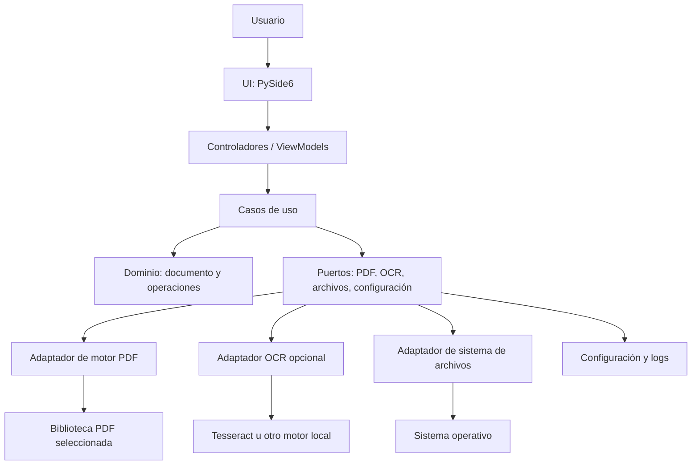
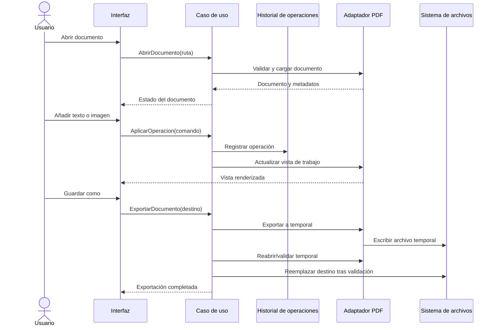

# Especificación técnica: aplicación de escritorio para editar PDF

- **Nombre provisional:** BENE PDF
- **Tipo:** aplicación de escritorio multiplataforma
- **Lenguaje principal:** Python 3.12+
- **Estado del documento:** propuesta inicial de requisitos y arquitectura
- **Plataformas objetivo:** Windows 10/11 y Linux;
- **Modo de operación:** local, sin requerir subir documentos a servicios externos

## 1. Visión y objetivo

Desarrollar una aplicación de escritorio que permita visualizar, organizar y editar documentos PDF, con especial atención a dos tareas:

1. **Edición de texto:** agregar texto, cubrir de forma permanente texto existente mediante redacción y escribir contenido nuevo en esa región, y corregir texto cuando el motor y la estructura del PDF lo permitan.
2. **Edición de imágenes:** insertar imágenes, reemplazar o eliminar imágenes cuando sea técnicamente posible, y mover, redimensionar o recortar los elementos gráficos compatibles.

La aplicación debe distinguir entre un PDF con texto seleccionable y uno formado por páginas escaneadas. En los documentos escaneados, el texto que se desea reconocer o modificar requiere OCR; la edición puede reconstruir visualmente una región, pero no siempre conservará exactamente la tipografía o el fondo originales.

## 2. Alcance

### 2.1 Incluido en la primera versión (MVP)

- Abrir, visualizar y guardar archivos PDF.
- Navegación entre páginas, zoom, ajuste a página/ancho y rotación de vista.
- Selección de texto y regiones rectangulares.
- Agregar cuadros de texto con control de fuente, tamaño, color, alineación y posición.
- Editar una región existente mediante un flujo controlado de **redacción del contenido anterior + inserción de texto nuevo**.
- Insertar imágenes desde archivos locales y ajustar su posición y tamaño.
- Eliminar/redactar regiones seleccionadas de forma permanente con confirmación explícita.
- Deshacer y rehacer las operaciones realizadas durante la sesión.
- Guardar como un archivo nuevo y evitar sobrescribir el original por defecto.
- Mostrar mensajes claros cuando una operación no pueda realizarse sin alterar el diseño.
- Ejecutarse sin conexión a Internet, salvo que en el futuro se habilite explícitamente una función externa.

### 2.2 Fuera del MVP, pero contemplado para versiones posteriores

- OCR para PDF escaneados, con idioma seleccionable y descarga/instalación local del motor.
- Edición avanzada de texto original preservando automáticamente fuentes, espaciado y distribución.
- Capas, anotaciones avanzadas, comentarios y formularios PDF.
- Firma digital, certificados, validación de firmas y gestión avanzada de permisos.
- Comparación visual entre versiones y procesamiento por lotes.
- Reconocimiento automático de tablas y reconstrucción de fondos complejos.
- Plugins de terceros y sincronización en la nube.

**Nota de alcance:** la modificación arbitraria del texto interno de cualquier PDF no puede garantizarse. Los PDF pueden contener fuentes incrustadas o subconjuntos de fuentes, texto convertido a trazados, contenido vectorial o páginas escaneadas. La interfaz debe explicar la diferencia entre añadir texto, redactar una zona y sustituir texto nativo.

## 3. Actores y casos de uso

- **Usuario final:** abre documentos, selecciona páginas o regiones, aplica cambios, revisa el resultado y exporta.
- **Motor PDF:** interpreta, renderiza y modifica el documento mediante una interfaz encapsulada.
- **Servicio OCR (opcional):** reconoce texto en páginas rasterizadas o zonas seleccionadas.

Casos de uso principales:

1. Abrir un PDF y recorrer sus páginas.
2. Añadir texto en una ubicación seleccionada.
3. Corregir contenido visualmente mediante redacción e inserción.
4. Insertar una imagen y ajustar su tamaño y ubicación.
5. Eliminar permanentemente una región que contenga información sensible.
6. Deshacer una operación o recuperar el estado anterior de la sesión.
7. Guardar los cambios en un nuevo archivo y volver a abrirlo para comprobar el resultado.

## 4. Requisitos funcionales (RF)

Prioridades: **M** = obligatorio para el MVP; **S** = siguiente fase; **F** = futuro.

| ID | Prioridad | Requisito | Criterio de aceptación |
|---|---|---|---|
| RF-001 | M | Abrir un archivo PDF desde un selector de archivos o arrastrándolo a la ventana. | Se abre un PDF válido y se muestra su primera página; los archivos inválidos producen un mensaje comprensible. |
| RF-002 | M | Renderizar páginas PDF en un visor con zoom y desplazamiento. | El usuario puede visualizar páginas completas sin que se bloquee la interfaz durante operaciones normales. |
| RF-003 | M | Navegar a la página anterior, siguiente o a un número de página. | La página mostrada coincide con el índice solicitado y se valida el rango. |
| RF-004 | M | Mostrar el número de páginas y el nombre del documento abierto. | La información se actualiza al abrir otro documento. |
| RF-005 | M | Detectar si una página contiene texto seleccionable. | El programa comunica si la página parece contener texto nativo, contenido mayormente gráfico o una imagen escaneada; esta detección es orientativa. |
| RF-006 | M | Seleccionar una región rectangular de la página. | La región seleccionada se representa visualmente y se convierte correctamente entre coordenadas de pantalla y coordenadas PDF. |
| RF-007 | M | Añadir un cuadro de texto. | El usuario define contenido, fuente disponible, tamaño, color, alineación y posición; el resultado se muestra antes de guardarse. Las fuentes Helvetica, Times-Roman y Courier se embeben y conservan euro, acentos y alfabetos latinos; los caracteres sin glifo se señalan antes de exportar. |
| RF-008 | M | Mover y redimensionar un cuadro de texto añadido. | El cuadro puede ajustarse con el ratón o controles numéricos y los cambios se reflejan en la vista previa. |
| RF-009 | M | Corregir visualmente texto existente usando redacción e inserción de texto nuevo. | La aplicación solicita confirmación antes de aplicar la redacción y señala que puede no reproducir exactamente la fuente o el fondo originales. |
| RF-010 | M | Redactar permanentemente una región. | El contenido subyacente de la región queda eliminado en el archivo exportado y no es recuperable mediante selección o copia de texto. |
| RF-011 | M | Insertar una imagen desde un archivo local. | Se admiten al menos PNG y JPEG; la imagen aparece en la página seleccionada. |
| RF-012 | M | Mover, redimensionar y eliminar una imagen insertada durante la sesión. | Las operaciones se reflejan en la vista previa y pueden deshacerse antes de exportar. Al redimensionar, la imagen se estira libremente; mantener pulsada **Shift** conserva su proporción. |
| RF-013 | S | Reemplazar una imagen ya existente en el PDF. | El usuario selecciona una imagen detectada y la sustituye; si el PDF no permite identificarla de manera fiable, la función explica la limitación. |
| RF-014 | M | Deshacer y rehacer cambios. | Las operaciones editables se almacenan en un historial de sesión y se revierten en orden. |
| RF-015 | M | Guardar como un archivo PDF nuevo. | El archivo exportado puede abrirse de nuevo y los cambios aparecen en la página correspondiente. El original no se sobrescribe por defecto. |
| RF-016 | M | Advertir ante cambios no guardados al cerrar o abrir otro documento. | El usuario puede guardar, descartar o cancelar la acción. |
| RF-017 | M | Gestionar errores de lectura, escritura, permisos o falta de espacio. | Se muestra una explicación accionable sin cerrar inesperadamente la aplicación ni dañar deliberadamente el original. |
| RF-018 | M | Mantener una copia de trabajo separada del archivo fuente. | Las modificaciones se aplican al documento de trabajo; el original permanece intacto hasta que el usuario elija explícitamente reemplazarlo. |
| RF-019 | S | Aplicar OCR a una página o región escaneada. | El usuario elige idioma; se ofrece el texto reconocido y se indica que el OCR puede contener errores. |
| RF-020 | S | Buscar texto en documentos que contengan texto reconocible. | Las coincidencias se muestran y se puede navegar a su página. Para texto escaneado, se necesita OCR. |
| RF-021 | S | Rotar páginas y extraer, reordenar o eliminar páginas. | El orden y la orientación se reflejan en el documento exportado y se validan las páginas seleccionadas. |
| RF-022 | S | Mostrar información del documento. | Se presentan número de páginas, tamaño del archivo, dimensiones y metadatos básicos disponibles. |
| RF-023 | S | Proteger operaciones destructivas con confirmación. | Las acciones de redacción permanente y eliminación de páginas muestran qué se eliminará antes de proceder. |
| RF-024 | F | Comparar visualmente antes y después. | Una vista dividida o alternable permite inspeccionar páginas antes de exportar. |
| RF-025 | F | Procesar múltiples archivos por lotes. | La aplicación informa el progreso y el resultado individual de cada archivo, sin detener todo el lote por un único error. |

### 4.1 Reglas de negocio

- **RN-001:** el archivo original se trata como solo lectura; las operaciones se ejecutan sobre una copia de trabajo.
- **RN-002:** el guardado por defecto crea un archivo nuevo; sobrescribir requiere una confirmación explícita.
- **RN-003:** una redacción es destructiva y debe diferenciarse de un rectángulo opaco superpuesto. Cubrir texto con una forma no equivale a eliminarlo.
- **RN-004:** antes de exportar, deben aplicarse realmente las redacciones pendientes al contenido del PDF; no basta con dibujar un rectángulo encima.
- **RN-005:** la aplicación no prometerá edición perfecta del texto original en todos los PDF. Informará cuando use el método de redacción más inserción.
- **RN-006:** el OCR es probabilístico; el usuario debe poder revisar y corregir el texto reconocido antes de utilizarlo.
- **RN-007:** una operación cancelada o fallida no debe dejar el archivo fuente parcialmente modificado.
- **RN-008:** los cambios de la sesión deben representarse como operaciones reversibles hasta que una operación destructiva se confirme y aplique a la copia de trabajo.

## 5. Requisitos no funcionales (RNF)

| ID | Categoría | Requisito verificable |
|---|---|---|
| RNF-001 | Rendimiento | En un equipo de referencia de 4 núcleos y 8 GB de RAM, abrir un PDF de 100 páginas de texto ordinario debe mostrar la primera página en un tiempo objetivo de 3 segundos o menos, sujeto al tamaño y complejidad del documento. |
| RNF-002 | Rendimiento | Renderizar páginas que no estén en caché debe ejecutarse fuera del hilo de interfaz gráfica para evitar congelamientos perceptibles. |
| RNF-003 | Escalabilidad | La aplicación debe procesar páginas de manera incremental y no renderizar todas las páginas a resolución máxima al abrir un documento. |
| RNF-004 | Fiabilidad | Los errores deben gestionarse con excepciones específicas y registros técnicos; no se deben capturar errores indiscriminadamente para ocultarlos. |
| RNF-005 | Integridad | Guardar debe ser transaccional en la medida que permita la biblioteca: escribir primero a un archivo temporal y reemplazar el destino solo tras validar el resultado. |
| RNF-006 | Seguridad | No ejecutar macros, scripts o contenido activo de PDF; el documento se considera entrada no confiable. |
| RNF-007 | Privacidad | Por defecto, documentos y resultados permanecen localmente y no se transmiten por red. |
| RNF-008 | Seguridad | La redacción debe eliminar el contenido seleccionado del PDF exportado, no limitarse a ocultarlo visualmente. Debe probarse mediante extracción de texto y revisión del contenido exportado. |
| RNF-009 | Compatibilidad | Definir y probar versiones soportadas de Windows y Linux; las rutas deben manejar espacios, caracteres Unicode y separadores específicos de cada sistema operativo. |
| RNF-010 | Usabilidad | Las operaciones principales (abrir, navegar, añadir texto, insertar imagen y guardar como) deben estar disponibles desde la interfaz principal y con etiquetas comprensibles. |
| RNF-011 | Accesibilidad | Controles principales con navegación por teclado, foco visible, etiquetas y contraste legible. |
| RNF-012 | Mantenibilidad | Separar la interfaz gráfica, los casos de uso, el dominio y los adaptadores de bibliotecas PDF/OCR. |
| RNF-013 | Testabilidad | La lógica de aplicación debe probarse sin iniciar la interfaz gráfica ni depender de archivos personales del usuario. |
| RNF-014 | Portabilidad | Configuración, temporales y registros deben guardarse en ubicaciones apropiadas del sistema operativo, no junto al ejecutable por defecto. |
| RNF-015 | Observabilidad | Registrar errores técnicos con rotación y sin guardar por defecto el texto completo de los documentos en los logs. |
| RNF-016 | Distribución | La aplicación debe poder empaquetarse como ejecutable instalable; las dependencias nativas de OCR, si se incluyen, deben documentarse. |
| RNF-017 | Calidad | Mantener tipado gradual, formato consistente, análisis estático y pruebas automatizadas en integración continua. |
| RNF-018 | Licenciamiento | Revisar licencias de todas las dependencias y fuentes antes de distribuir. La elección del motor PDF puede imponer condiciones distintas según se use AGPL, MPL, BSD u otra licencia. |

Los objetivos numéricos de rendimiento deben validarse con PDFs de prueba representativos; no son una garantía universal para documentos escaneados de gran resolución o con gráficos complejos.

## 6. Arquitectura propuesta

### 6.1 Estilo arquitectónico

Se propone una arquitectura **por capas inspirada en arquitectura limpia/puertos y adaptadores**:

- **Presentación:** interfaz gráfica y estado visual.
- **Aplicación:** casos de uso que orquestan operaciones y validaciones.
- **Dominio:** modelos, comandos, reglas de negocio e historial de operaciones.
- **Puertos:** contratos para renderizado, edición, almacenamiento, OCR y preferencias.
- **Adaptadores e infraestructura:** implementación concreta de PDF, sistema de archivos, OCR, configuración y logs.

La interfaz no debe importar directamente APIs específicas del motor PDF. Debe llamar a casos de uso mediante servicios de aplicación, lo que permite sustituir el motor o probar la lógica de manera aislada.

### 6.2 Diagrama de componentes



### 6.3 Flujo de edición y guardado



### 6.4 Modelo de edición recomendado

Para facilitar deshacer/rehacer y conservar el archivo original, registrar las modificaciones como comandos independientes, por ejemplo:

- `AddTextCommand`
- `MoveTextCommand`
- `AddImageCommand`
- `MoveImageCommand`
- `ResizeImageCommand`
- `RedactRegionCommand`
- `RotatePageCommand`
- `DeletePageCommand`

Cada comando debe contener página, coordenadas PDF y los parámetros necesarios para aplicar o revertir la operación cuando sea posible. Para operaciones irreversibles, mantener el original intacto y ejecutar sobre una copia de trabajo; no ofrecer una reversión falsa si el motor ya eliminó contenido.

Las coordenadas deben manejarse en un sistema consistente (coordenadas de página PDF) y traducirse en un único componente entre el visor, el zoom, la rotación y el motor PDF.

## 7. Tecnologías sugeridas

| Área | Opción inicial | Consideraciones |
|---|---|---|
| Lenguaje | Python 3.12 o versión estable compatible con dependencias | Fijar versión mínima y probar dependencias en CI. |
| Interfaz de escritorio | PySide6 (Qt for Python) | Adecuada para visor, herramientas, diálogos, señales y tareas en segundo plano. Revisar condiciones de licencia Qt para la distribución elegida. |
| Motor PDF | Evaluar PyMuPDF como adaptador inicial | Ofrece renderizado, extracción, anotaciones y redacción; revisar cuidadosamente sus condiciones AGPL/comerciales antes de distribuir. |
| Alternativas PDF | pypdf y/o pikepdf para operaciones de estructura y metadatos | No sustituyen por sí solas todas las funciones de renderizado y edición visual. Verificar compatibilidad y licencias en la versión seleccionada. |
| Manipulación de imágenes | Pillow | Conversión, dimensiones y preparación de imágenes. |
| OCR opcional | Tesseract + wrapper de Python | Requiere motor y paquetes de idioma instalados; comprobar licencia y empaquetado. |
| Pruebas | pytest, pytest-qt | Pruebas unitarias, de integración y de interacción de UI. |
| Calidad | Ruff, mypy o pyright | Lint, formato y comprobación de tipos. |
| Empaquetado | PyInstaller | Producir builds por sistema operativo; probar rutas, plugins Qt y dependencias nativas. |
| CI | GitHub Actions | Ejecutar pruebas y análisis estático en los sistemas soportados. |

**Decisión pendiente antes de distribuir:** revisar la licencia y compatibilidad de cada biblioteca con el modelo de distribución del proyecto. PyMuPDF, por ejemplo, no debe elegirse ignorando sus condiciones AGPL/comerciales. Esta especificación no sustituye una revisión legal de licencias.

## 8. Estructura propuesta del proyecto

```text
pdf-studio-local/
├── README.md
├── README.es.md
├── LICENSE
├── pyproject.toml
├── requirements-dev.txt
├── .gitignore
├── .pre-commit-config.yaml
├── docs/
│   ├── requirements.md
│   ├── architecture.md
│   ├── decisions/
│   │   ├── ADR-001-desktop-ui.md
│   │   └── ADR-002-pdf-engine.md
│   └── test-plan.md
├── src/
│   └── pdf_studio/
│       ├── __init__.py
│       ├── main.py
│       ├── bootstrap.py
│       ├── config/
│       │   ├── __init__.py
│       │   └── settings.py
│       ├── domain/
│       │   ├── __init__.py
│       │   ├── models/
│       │   │   ├── pdf_document.py
│       │   │   ├── page_info.py
│       │   │   ├── text_object.py
│       │   │   ├── image_object.py
│       │   │   └── edit_operation.py
│       │   ├── commands/
│       │   │   ├── base.py
│       │   │   ├── add_text.py
│       │   │   ├── add_image.py
│       │   │   ├── redact_region.py
│       │   │   └── transform_object.py
│       │   └── errors.py
│       ├── application/
│       │   ├── use_cases/
│       │   │   ├── open_document.py
│       │   │   ├── render_page.py
│       │   │   ├── apply_operation.py
│       │   │   ├── search_text.py
│       │   │   └── export_document.py
│       │   ├── services/
│       │   │   ├── editor_service.py
│       │   │   └── history_service.py
│       │   └── ports/
│       │       ├── pdf_engine.py
│       │       ├── ocr_engine.py
│       │       ├── file_store.py
│       │       └── settings_store.py
│       ├── infrastructure/
│       │   ├── pdf/
│       │   │   ├── pymupdf_adapter.py
│       │   │   └── pdf_factory.py
│       │   ├── ocr/
│       │   │   └── tesseract_adapter.py
│       │   ├── storage/
│       │   │   └── local_file_store.py
│       │   └── logging/
│       │       └── logging_config.py
│       ├── presentation/
│       │   ├── main_window.py
│       │   ├── viewmodels/
│       │   │   ├── document_viewmodel.py
│       │   │   └── editor_viewmodel.py
│       │   ├── widgets/
│       │   │   ├── pdf_viewer.py
│       │   │   ├── page_navigator.py
│       │   │   ├── properties_panel.py
│       │   │   └── tool_bar.py
│       │   └── dialogs/
│       │       ├── open_dialog.py
│       │       ├── export_dialog.py
│       │       └── redact_confirmation.py
│       └── resources/
│           ├── icons/
│           └── styles/
├── tests/
│   ├── unit/
│   │   ├── test_history_service.py
│   │   ├── test_commands.py
│   │   └── test_coordinate_mapper.py
│   ├── integration/
│   │   ├── test_pdf_export.py
│   │   ├── test_text_redaction.py
│   │   └── test_image_insertion.py
│   ├── ui/
│   │   └── test_main_window.py
│   └── fixtures/
│       ├── text_sample.pdf
│       ├── scanned_sample.pdf
│       └── image_sample.png
├── scripts/
│   ├── run_dev.py
│   └── build_app.py
└── .github/
    └── workflows/
        └── ci.yml
```

La estructura es orientativa: crear únicamente los módulos que se implementen en cada iteración. Evitar archivos vacíos o capas sin responsabilidad real.

## 9. Contratos clave entre capas

Los puertos deben definir contratos de alto nivel sin exponer tipos internos de PyMuPDF u otra biblioteca.

Ejemplo conceptual de operaciones del puerto PDF:

```python
from pathlib import Path
from typing import Protocol, Any

class PdfEngine(Protocol):
    def open_document(self, path: Path) -> Any: ...
    def get_page_count(self, document: Any) -> int: ...
    def render_page(self, document: Any, page_index: int, scale: float) -> Any: ...
    def add_text(self, document: Any, page_index: int, payload: dict) -> None: ...
    def add_image(self, document: Any, page_index: int, payload: dict) -> None: ...
    def redact_region(self, document: Any, page_index: int, rect: tuple[float, float, float, float]) -> None: ...
    def save_to(self, document: Any, destination: Path) -> None: ...
    def close_document(self, document: Any) -> None: ...
```

Este bloque ilustra el contrato y no es una implementación final. En código real, reemplazar `Any` y `dict` por modelos tipados específicos, definir errores de dominio y documentar quién es responsable de cerrar los recursos.

## 10. Diseño de interfaz sugerido

Ventana principal organizada en cuatro zonas:

1. **Barra superior:** Abrir, Guardar como, Deshacer, Rehacer, Zoom y Exportar.
2. **Panel lateral izquierdo:** miniaturas de páginas y navegación.
3. **Área central:** visor PDF y selección interactiva de elementos.
4. **Panel lateral derecho:** herramientas y propiedades del elemento seleccionado (texto, imagen, posición, dimensiones, color, tipografía).

Herramientas principales: **Seleccionar**, **Añadir texto**, **Insertar imagen**, **Redactar región**, **Mover/Redimensionar**. Las herramientas destructivas deben tener icono y etiqueta claramente distinguibles.

## 11. Seguridad, privacidad e integridad del PDF

- Tratar todos los PDF como entradas potencialmente malformadas o maliciosas.
- Limitar memoria y resolución de renderizado; evitar cargar todas las páginas a máxima resolución simultáneamente.
- Guardar de manera atómica cuando sea posible y conservar el original hasta validar la exportación.
- No guardar contraseñas ni contenido completo de documentos en logs.
- Para PDF cifrados, solicitar la contraseña únicamente en memoria; no registrar el valor. Si el MVP no admite cifrado, rechazarlo de forma explícita y segura.
- La redacción debe probarse con extracción de texto, búsquedas y comprobaciones visuales sobre el archivo exportado. Eliminar texto visible no garantiza por sí solo la eliminación de metadatos, adjuntos, capas u otras copias del contenido; estos aspectos necesitan una revisión de saneamiento adicional.
- Documentar que las firmas digitales existentes pueden dejar de ser válidas tras modificar el documento.
- No afirmar que el documento queda anonimizado o sanitizado de forma completa salvo que exista una función específica, probada y documentada para ello.

## 12. Estrategia de pruebas

### 12.1 Pruebas unitarias

- Conversión entre coordenadas de pantalla y coordenadas PDF con diferentes niveles de zoom y rotación.
- Orden de operaciones de deshacer/rehacer.
- Validación de páginas, rectángulos, rutas y tipos de imagen.
- Reglas de negocio para confirmar operaciones destructivas.

### 12.2 Pruebas de integración

- Abrir y exportar PDF de texto, PDF escaneado y PDF con imágenes.
- Insertar texto e imágenes y comprobar su presencia después de volver a abrir el archivo exportado.
- Aplicar redacción y verificar que el texto redactado no puede extraerse del resultado.
- Comprobar que un error de guardado no daña el archivo fuente.
- Probar PDF cifrados, corruptos, con rotación, páginas de tamaño distinto y nombres de archivo Unicode.

### 12.3 Pruebas de interfaz

- Apertura, navegación, selección de herramientas, cancelación, confirmación de redacción y guardado.
- Advertencia de cambios sin guardar.
- Respuesta de la interfaz durante renderizado y exportación.
- Uso de controles con teclado y escalado de pantalla.

### 12.4 Datos de prueba

Crear documentos sintéticos sin información personal: PDF con texto nativo, PDF escaneado, páginas rotadas, imágenes de distintos formatos, una página con varias columnas y un documento con contenido difícil de extraer. Los fixtures deben distribuirse legalmente junto al repositorio.

## 13. Criterios de aceptación del MVP

La versión inicial se considera aceptable cuando:

1. Puede abrir y navegar un PDF de texto y uno con páginas escaneadas.
2. Permite insertar, mover y redimensionar texto añadido e imágenes.
3. Permite corregir visualmente una región a través de redacción real e inserción de texto nuevo.
4. Distingue la redacción permanente de una simple forma que cubre contenido.
5. Ofrece deshacer/rehacer para las operaciones soportadas durante la sesión.
6. Exporta a un archivo nuevo, vuelve a abrirlo y conserva los cambios esperados.
7. El archivo fuente permanece intacto si no se solicita expresamente reemplazarlo.
8. Los errores de archivo o escritura se informan y no provocan un cierre inesperado.
9. Las pruebas automatizadas principales se ejecutan en el entorno de integración continua.
10. Las dependencias elegidas tienen sus licencias documentadas para el modo de distribución previsto.

## 14. Plan de implementación por iteraciones

### Iteración 1 — Esqueleto de la aplicación

- Crear entorno Python, configuración de proyecto, lint y pruebas.
- Crear ventana PySide6.
- Abrir PDF, mostrar la primera página y navegar entre páginas.
- Encapsular el motor PDF detrás del puerto `PdfEngine`.

### Iteración 2 — Herramientas de edición básicas

- Implementar selección y conversión de coordenadas.
- Añadir cuadros de texto e imágenes.
- Crear historial de comandos y deshacer/rehacer.

### Iteración 3 — Redacción y exportación segura

- Implementar redacción permanente con confirmación.
- Exportar a archivo temporal y validar la salida.
- Añadir pruebas que comprueben que el texto redactado no sigue siendo extraíble.

### Iteración 4 — Calidad y distribución

- Completar mensajes de error, accesibilidad y documentación.
- Probar PDF grandes, rotados, con imágenes y casos inválidos.
- Generar builds para los sistemas operativos soportados.

### Iteración 5 — OCR y funciones adicionales

- Integrar OCR local opcional.
- Incorporar búsqueda, reemplazo asistido y operaciones de páginas según prioridad.

## 15. Riesgos y decisiones pendientes

| Riesgo o decisión | Impacto | Mitigación / siguiente paso |
|---|---|---|
| Editar texto nativo sin alterar el diseño puede ser imposible en ciertos PDF. | Alto | Ofrecer modos claramente separados: añadir, redacción + inserción y OCR/reconstrucción. |
| La redacción puede eliminar objetos que se solapan con la región. | Alto | Vista previa, confirmación y pruebas con objetos cercanos. |
| Licencia del motor PDF incompatible con la distribución deseada. | Alto | Registrar una decisión de arquitectura (ADR), revisar licencias y evaluar alternativas antes de publicar. |
| OCR comete errores con tablas, baja resolución o varios idiomas. | Medio | Permitir elegir idioma, revisar resultado y no modificar el original automáticamente. |
| PDFs complejos consumen mucha memoria o tardan en renderizar. | Medio | Renderizado por demanda, caché con límite y tareas en segundo plano. |
| Firmas digitales dejan de ser válidas después de editar. | Medio | Aviso al abrir/editar y documentación explícita. |

Decisiones pendientes antes del desarrollo completo:

- Definir si el proyecto será de uso personal, de código abierto o comercial.
- Confirmar sistemas operativos y versiones mínimas.
- Decidir si OCR entra en el MVP o se entrega como módulo opcional.
- Elegir motor PDF después de validar funciones requeridas y condiciones de licencia.
- Establecer límites objetivo de tamaño de archivo, memoria y tiempo de respuesta.

## 16. Definición de terminado (Definition of Done)

Una funcionalidad se considera terminada cuando:

- Cumple el requisito asociado y sus criterios de aceptación.
- Incluye pruebas adecuadas y pasan las pruebas existentes.
- Maneja errores y recursos del documento de forma explícita.
- No modifica el archivo fuente de forma involuntaria.
- Incluye documentación de uso y limitaciones relevantes.
- Respeta las capas de arquitectura y no acopla la interfaz a la biblioteca PDF.
- Está revisada en cuanto a seguridad, privacidad y licencias cuando corresponda.

---

**Nota:** este archivo define una base de análisis y diseño; no implica que el código esté implementado. Los nombres de bibliotecas y las metas de rendimiento deben validarse con un prototipo y con las licencias de las versiones efectivamente elegidas.
